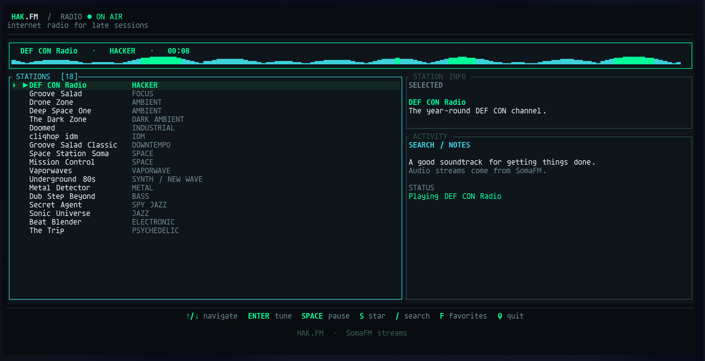

# HAK.FM TUI

A Rust terminal radio receiver for hacker focus, ambient work sessions, and late-night debugging. Built with Ratatui and Crossterm; audio playback is handled by `mpv`.

> This is an independent client, not an official HAK.FM project. It currently uses direct SomaFM MP3 streams for its station presets. It does not scrape or depend on HAK.FM's website.




## Features

- 18 curated radio presets including DEF CON Radio, Drone Zone, Groove Salad, and Deep Space One
- Keyboard navigation and station switching
- Search by station name, genre, or description
- Favorites saved in `~/.config/hakfm/config.json`
- Playback status, elapsed session timer, and connection-ended detection
- No browser required


# You have two ways to get this working


## Easiest method : Download the pre-built binary (NOT RECOMMENDED)
https://github.com/Deltafsociety/hakfm-TUI/releases/download/v1.0.0.0/hakfm

the open a terminal and navigate where the downloaded binary is
and run :
```bash
chmod +x hakfm
```

and then 

```bash
./hakfm
```


## OR Build from source ( RECOMMENDED like all champs do :D)
> Follow the below steps:


## Step 1
On Arch Linux:

```bash
sudo pacman -S rust mpv
```

on Ubuntu ( debian based):

```bash
sudo apt install rust mpv
```
---

## Step 2 
Download the project zip file

[DOWNLOAD ZIP](https://github.com/Deltafsociety/hakfm-TUI/archive/refs/heads/main.zip)

---

## step 3
open a terminal and navigate the *extracted* folder

```bash 
cd YOUR_DOWNLOAD_PATH
```

```bash
unzip hakfm-TUI-main.zip
```


```bash
cd hakfm-TUI-main
```

RUN this :

```bash 
chmod +x ./build.sh
```
> This gives the install script execution rights.

then after the script is done you can run
 ```bash 
hakfm
```
OR
```bash
radio
```

in order to launch the application

# Step 4

- Star this project!
- feel free to open issues
- enjoy your deep focous sessions
- visit my [Open Focus](https://github.com/Deltafsociety/open-focus) Project :D


## Controls

> both dorky style and Legend VIM style ( for champs ) are implemented :D 

| Key | Action |
|---|---|
| `↑` / `k`, `↓` / `j` | Navigate stations |
| `Enter` | Play selected station |
| `Space` | Stop/resume the selected station |
| `←` / `h`, `→` / `l` | Tune previous/next station |
| `/` | Search |
| `s` | Add/remove favorite |
| `f` | Show favorites only |
| `x` | Stop playback |
| `r` | Reset filters |
| `?` | Help |
| `q` | Quit |

## Notes

- Streams can change or become unavailable. If one fails, try another station.
- The `Space` key stops and restarts a station when resuming. Seamless pause/resume and volume controls would require adding mpv IPC.
- The preset URLs use SomaFM's public MP3 stream pattern. The receiver does not host or redistribute audio.
- On quit, the application terminates the `mpv` process it started.


The moving bar is a lightweight animated visual, not an audio-spectrum measurement. Playback is handled by `mpv`; station streams are provided by SomaFM.
