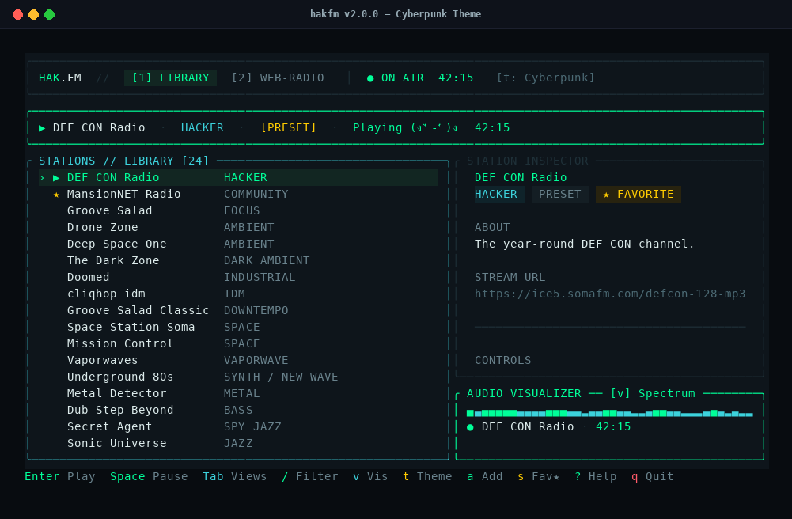
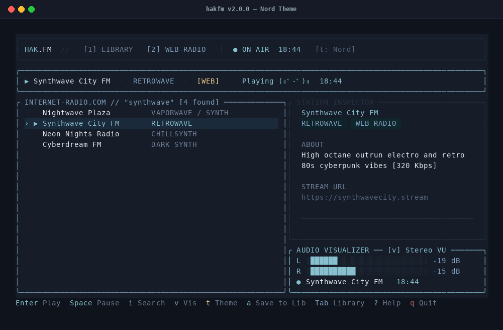
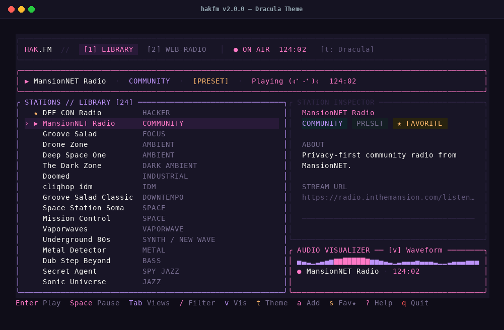

# 📻 HAK.FM TUI (v2.0)

<div align="center">

```
██╗  ██╗ █████╗ ██╗  ██╗███████╗███╗   ███╗
██║  ██║██╔══██╗██║ ██╔╝██╔════╝████╗ ████║
███████║███████║█████╔╝ █████╗  ██╔████╔██║
██╔══██║██╔══██║██╔═██╗ ██╔══╝  ██║╚██╔╝██║
██║  ██║██║  ██║██║  ██╗██║     ██║ ╚═╝ ██║
╚═╝  ╚═╝╚═╝  ╚═╝╚═╝  ╚═╝╚═╝     ╚═╝     ╚═╝
```

**A cyber-aesthetic terminal radio receiver for deep focus, ambient hacking, and late-night debugging.**

[](https://github.com/Deltafsociety/hakfm-TUI/releases/latest)
[](https://github.com/Deltafsociety/hakfm-TUI)
[](LICENSE)
[](https://ratatui.rs)

> *"Because running a 2GB RAM-devouring browser with 80 tabs just to listen to synthwave while your compiler is already setting your laptop on fire is a crime against humanity."*

<br/>



<p align="center">
  <i>Main Library View with Cyberpunk theme, live DEF CON Radio, and animated audio spectrum</i>
</p>

</div>

---

### 📸 More Screenshots

<div align="center">

| ❄️ Nord Theme + Web-Radio Search | 🧛 Dracula Theme + Waveform Visualizer |
|:---:|:---:|
|  |  |
| *Live in-TUI internet-radio.com station browser* | *Dracula aesthetic with flowing audio waveform* |

</div>

---

## ✨ Features

- 🎧 **Curated Hacker Presets:** Tune into DEF CON Radio, MansionNET Radio, Drone Zone, Groove Salad, Deep Space One, Mission Control, Vaporwaves, and underground 80s synth.
- 🌐 **In-TUI Live Web Search:** Browse and search thousands of global stations across every genre on [internet-radio.com](https://www.internet-radio.com/) without leaving the terminal.
- 📊 **Animated Audio Visualizer (<kbd>v</kbd>):** Switch between **Spectrum**, **Waveform**, **Stereo VU Peak Meter**, **Matrix Dots**, or **Off** when you need maximum minimalism.
- 🎨 **5 Curated Color Themes (<kbd>t</kbd>):**
  - `Cyberpunk` — High-voltage neon green & cyan
  - `Matrix` — Pure phosphorescent terminal green
  - `Nord` — Cool arctic frost & deep polar night
  - `Dracula` — Vampire purple & dark pastel glow
  - `Stealth` — Slate monochrome for quiet midnight sessions
- ➕ **Custom Station Manager (<kbd>a</kbd>):** Add your own Icecast, Shoutcast, `.pls`, or `.mp3` streams in two seconds.
- ⭐ **Favorites & Search (<kbd>s</kbd> / <kbd>/</kbd>):** Star your go-to channels and filter large libraries instantly.
- 🪶 **Zero Bloat:** Written in 100% safe Rust. Starts in 10ms, takes ~12MB of RAM, and delegates audio decoding to the rock-solid `mpv`.
- 🐧 **Sister-Approved Universal Compatibility:** Works seamlessly out of the box on Linux Mint, Ubuntu, Debian, Arch, Fedora, and macOS.

---

## ⚡ Quick Install

The easiest way to get rolling (auto-detects your OS, architecture, and toolchain):

```bash
curl -fsSL https://raw.githubusercontent.com/Deltafsociety/hakfm-TUI/main/install.sh | bash
```

> **Requirements:** Just `mpv` for audio streaming (`sudo apt install mpv`, `sudo pacman -S mpv`, or `brew install mpv`).

After install, launch it anytime with:
```bash
hakfm
# or just:
radio
```

---

## 📦 Alternative Installations

<details>
<summary><b>Option A: Download Static Pre-Built Binary</b></summary>
<br/>

Grab the static binary for your machine from [GitHub Releases](https://github.com/Deltafsociety/hakfm-TUI/releases/latest) (built with `musl`, zero glibc version mismatches):

```bash
# Example for Linux x86_64:
curl -LO https://github.com/Deltafsociety/hakfm-TUI/releases/latest/download/hakfm-linux-x86_64
chmod +x hakfm-linux-x86_64
mv hakfm-linux-x86_64 ~/.local/bin/hakfm
```
</details>

<details>
<summary><b>Option B: Install via Cargo</b></summary>
<br/>

```bash
cargo install --git https://github.com/Deltafsociety/hakfm-TUI.git
```
</details>

<details>
<summary><b>Option C: Build From Source</b></summary>
<br/>

```bash
git clone https://github.com/Deltafsociety/hakfm-TUI.git
cd hakfm-TUI
./build.sh
```

*(Note: Modern Rust dependencies require Rust 1.85+. If your distro's apt is stuck on an older version, install official Rust via `curl --proto '=https' --tlsv1.2 -sSf https://sh.rustup.rs | sh`).*
</details>

---

## 🎮 Keyboard Controls

> Both normal human arrow keys and legendary Vim keys (`hjkl`) are supported — no judgment here.

| Key | Action |
|---|---|
| `↑` / `k`, `↓` / `j` | Navigate station list |
| `Enter` | Tune in & play selected station |
| `Space` | Pause / resume playback |
| `←` / `h`, `→` / `l` | Previous / next station |
| `Tab` / `1` / `2` | Toggle views (**Library** ⟷ **Internet-Radio**) |
| `i` | Search [internet-radio.com](https://www.internet-radio.com/) from inside the TUI |
| `a` | Add custom station URL (or save Internet-Radio station to library) |
| `d` / `Delete` | Delete custom station |
| `/` | Instant filter stations in library |
| `s` | Star / favorite station |
| `f` | Show favorites only |
| `v` | Cycle visualizer (*Spectrum → Waveform → Stereo VU → Matrix Dots → Off*) |
| `t` | Cycle color theme (*Cyberpunk → Matrix → Nord → Dracula → Stealth*) |
| `x` | Stop playback |
| `r` | Reset all search filters |
| `?` | Keyboard shortcut cheat sheet |
| `q` / `Esc` | Quit like a civilized hacker |

---

## 💜 Support & Donations

> If **hakfm** saved your sanity during a 3 AM debugging spiral, soundtracked a late-night hacking session, or you just respect free & open-source software built without corporate telemetry, consider tossing some caffeine my way:

<div align="left">

[](https://zist.digital/delta/contact-me/)
[](https://zist.digital/delta/contact-me/)
[](https://zist.digital/delta/contact-me/)

</div>

- **Tip / Support:** Reach out or tip via [Delta's Contact & Support Page](https://zist.digital/delta/contact-me/)
- **Monero (XMR) & BCH:** Accepted with open arms — check the contact link above for fresh addresses!
- **Star the Repo ⭐:** Free, takes 0.5 seconds, and releases endorphins in my brain.

---

## 🛰️ Notes & Acknowledgements

- **Station Streams:** Stream presets are sourced from public SomaFM MP3 streams. Audio streaming is powered by `mpv`. This client does not scrape, rehost, or redistribute copyright audio.
- **Config & Persistence:** Your custom stations, favorites, selected visualizer, and chosen theme are neatly stored in `~/.config/hakfm/config.json`.
- **Sister Project:** Also check out [Open Focus](https://github.com/Deltafsociety/open-focus) for deep-work focus timer tools.

---

<div align="center">

Forged with ☕ and paranoia by **[Delta Fsociety](https://zist.digital/delta/contact-me/)**

*`// stay paranoid, stay free`*

</div>
